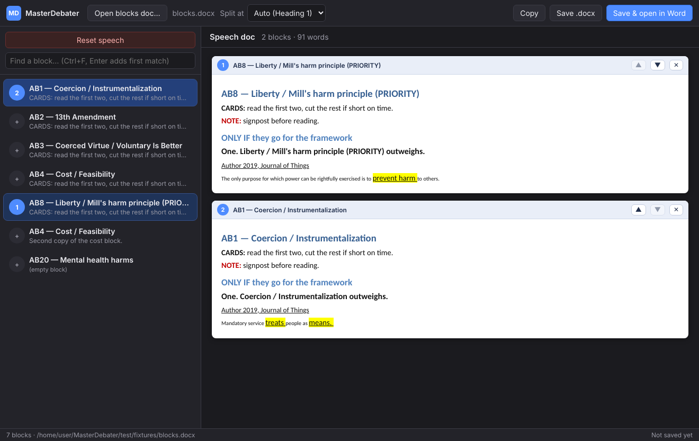

# MasterDebater

A one-click speech-doc builder for debate. Your blocks stay in the Word
document you already have. MasterDebater lists them down the side, and each
click adds a block to the speech doc or takes it back out. When you're ready,
save the speech as a `.docx` (or open it straight in Word) with every bit of
formatting — highlighting, underlining, sizes, colours — copied over verbatim.



## Install (Windows)

1. Download `MasterDebater-<version>-win-x64.exe` from the
   [Releases](../../releases) page (or use the portable `.exe` if you don't
   want an installer).
2. Run it. It installs for your user only (no admin prompt) and puts a shortcut
   on the desktop and Start menu.

Windows SmartScreen may warn that the publisher is unknown, because the app
isn't code-signed. Click **More info → Run anyway**.

## Using it

1. **Open blocks doc…** and pick the Word file that holds your blocks.
   Every paragraph in a Word **Heading** style (Heading 1, Heading 2, …)
   starts a new block, exactly like the Navigation pane in Word. Everything
   under the heading, up to the next heading, is that block.
2. **Click a block** in the list to add it to the speech doc. **Click it
   again** to remove it. Blocks appear in the order you add them; use ▲ ▼ in
   the speech pane to reorder.
3. **Reset speech** (top of the list) clears the speech doc.
4. **Save & open in Word** writes the speech to a `.docx` and opens it. You can
   also **Save .docx** (pick a name once, then Ctrl+S overwrites it) or
   **Copy** the whole speech and paste it into any open Word document.

Other things it does for you:

- **Live reload.** Edit your blocks in Word and save; the list refreshes
  itself within a couple of seconds.
- **Search.** Ctrl+F, type part of a block name, press Enter to add the first
  match.
- **Remembers everything.** The blocks file, your current speech, and where you
  saved it are restored next time you open the app.
- **Split at.** If your file uses Heading 1 for sections and Heading 2 for
  blocks (or any other mix), change the heading level in the top bar. "Auto"
  picks the level used most often.
- **Word has the file open?** If you saved, opened in Word, then added more
  blocks, Word will be holding the file. The app offers to save as
  `Speech (2).docx` instead.

Keyboard shortcuts: Ctrl+O open blocks · F5 reload · Ctrl+F find ·
Ctrl+S save · Ctrl+Shift+S save as · Ctrl+Enter save and open in Word ·
Ctrl+Shift+C copy · Ctrl+Shift+R reset.

## Building from source

Requires [Node.js](https://nodejs.org) 20 or newer.

```
npm install
npm start          # run the app
npm test           # engine tests (parsing, rendering, .docx output)
npm run dist       # build the Windows installer + portable exe into dist/
npm run dist:mac   # build a macOS .dmg (run on a Mac)
```

## How it works

- `src/main.js` — Electron main process: window, file dialogs, disk I/O,
  settings in `%APPDATA%\MasterDebater\settings.json`, watches the blocks file.
- `src/renderer/docx.js` — reads the `.docx` (a zip of XML), resolves Word
  styles so bold/underline/highlight applied through styles still show, splits
  the body into blocks by heading, and builds the speech `.docx` by copying the
  chosen paragraphs' original XML into a fresh body, keeping the source
  document's styles, numbering, fonts and images. Nothing is re-typed, so
  nothing is lost.
- `src/renderer/app.js` — the UI.
- `test/` — a generated fixture document and engine tests (`npm test`).

Only `.docx` files are supported. If your blocks are in an older `.doc`, open
it in Word and Save As → Word Document (.docx).
